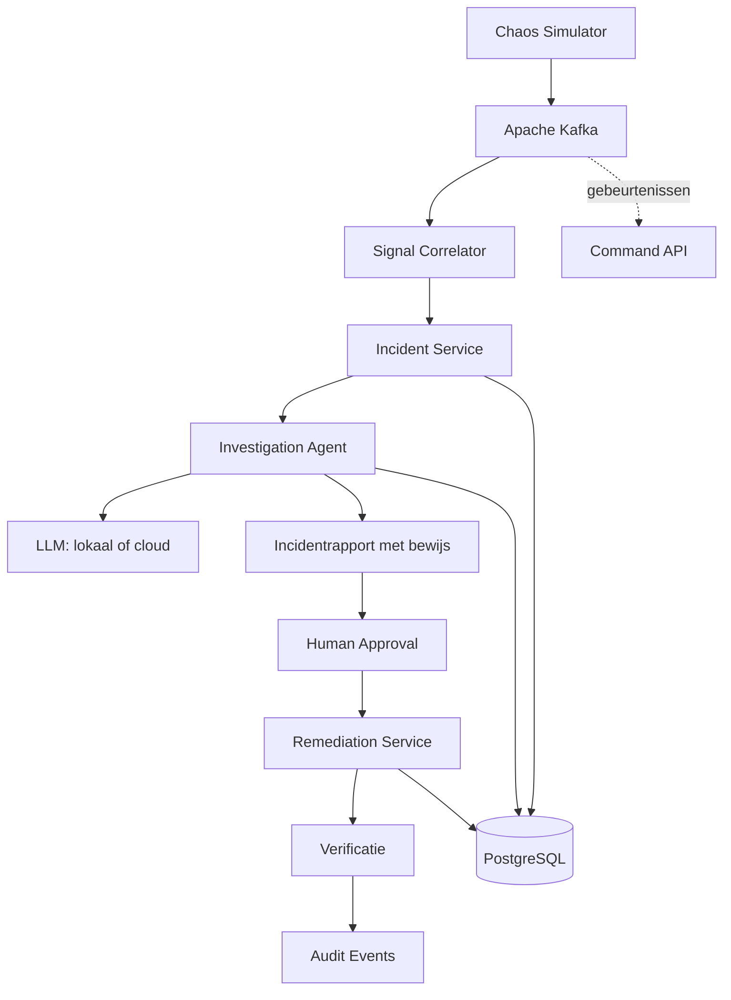

# AI Incident Commander

**Een event-driven AI-platform voor het automatisch analyseren, onderzoeken en oplossen van IT-incidenten.**

[](https://www.oracle.com/java/)
[](https://spring.io/projects/spring-boot)
[](https://kafka.apache.org/)
[](https://kubernetes.io/)
[](https://github.com/embabel)

## Over dit project

**AI Incident Commander** is een experimenteel platform dat laat zien hoe moderne Java-technologie, event-driven microservices en AI-agents kunnen samenwerken om IT-incidenten sneller te detecteren, te onderzoeken en gecontroleerd op te lossen.

Het platform simuleert operationele gebeurtenissen, zoals verhoogde foutpercentages, latencyproblemen en mislukte deployments. Op basis van deze signalen worden incidenten gedetecteerd en wordt een AI-agent ingeschakeld om mogelijke oorzaken te onderzoeken, bewijs te verzamelen en herstelmaatregelen voor te stellen.

De oplossing is ontworpen rond een belangrijk uitgangspunt:

> **AI onderzoekt en adviseert. Gecontroleerde automatisering voert uit. Een mens houdt de regie.**

Het project is bedoeld als demonstratie van moderne softwarearchitectuur en engineeringpraktijken voor cloud-native, event-driven en AI-ondersteunde systemen.

## Doelstellingen

- Implementatie van event-driven microservices met Java en Spring Boot.
- Asynchrone communicatie via Apache Kafka.
- Inzet van AI-agents voor het analyseren en onderzoeken van incidenten.
- Gebruik van Embabel voor goal-oriented AI-agentworkflows.
- Ondersteuning voor lokale taalmodellen en optionele cloudgebaseerde LLM's.
- Uitvoering op Kubernetes met Helm.
- Integratie van observability, tracing, metrics en gestructureerde logging.
- Veilige, controleerbare en idempotente verwerking van herstelacties.
- Uitgebreide geautomatiseerde tests en een reproduceerbare demonstratie.

## Architectuur



### Belangrijkste componenten

| Component | Verantwoordelijkheid |
|---|---|
| `chaos-simulator` | Genereert gesimuleerde telemetrie-, infrastructuur- en deploymentgebeurtenissen. |
| `signal-correlator` | Analyseert signalen en detecteert incidenten met deterministische regels. |
| `incident-service` | Beheert incidenten, statussen en verzameld bewijs. |
| `investigation-agent` | Onderzoekt incidenten met behulp van een AI-agent en een taalmodel. |
| `remediation-service` | Beheert voorgestelde herstelacties, goedkeuring en gecontroleerde uitvoering. |
| `command-api` | Biedt een API voor het opvragen en beheren van incidenten. |

De componenten communiceren waar mogelijk asynchroon via Kafka. Hierdoor zijn ze onafhankelijk schaalbaar en kunnen fouten en tijdelijke onderbrekingen gecontroleerd worden afgehandeld.

## Technologiestack

| Technologie | Toepassing |
|---|---|
| Java | Primaire programmeertaal |
| Spring Boot | Microservices en REST-API's |
| Gradle | Build- en dependencybeheer |
| Apache Kafka | Event-driven communicatie |
| Avro en Schema Registry | Versiebeheer en validatie van eventcontracten |
| Embabel | Goal-oriented AI-agents |
| Spring AI | Integratie met taalmodellen |
| Ollama | Lokale uitvoering van taalmodellen |
| PostgreSQL | Persistente opslag van incidenten en onderzoeksresultaten |
| Kubernetes en Helm | Containerorkestratie en deployment |
| OpenTelemetry | Tracing en telemetry |
| Prometheus en Grafana | Metrics en dashboards |
| Testcontainers | Integratietests met echte infrastructuurcomponenten |

De precieze versies en compatibiliteit van de dependencies worden bij de implementatie vastgelegd en getest.

## Hoe werkt het?

Een demonstratiescenario doorloopt de volgende stappen:

1. **Incident simuleren** — de simulator genereert bijvoorbeeld een sterke toename van HTTP 5xx-fouten na een deployment.
2. **Signalen verwerken** — de correlatieservice combineert relevante gebeurtenissen en detecteert een mogelijk incident.
3. **Onderzoek starten** — een AI-agent ontvangt een onderzoeksopdracht met de beschikbare incidentgegevens.
4. **Oorzaak onderzoeken** — de agent analyseert logs, metrics, deploymentinformatie en andere beschikbare bewijsmiddelen.
5. **Diagnose opstellen** — het systeem produceert een rapport met een waarschijnlijke oorzaak, onderbouwing, onzekerheden en aanbevolen vervolgstappen.
6. **Goedkeuring vragen** — een bevoegde gebruiker beoordeelt een voorgestelde herstelactie.
7. **Herstel uitvoeren** — de remediation-service voert uitsluitend toegestane en goedgekeurde acties uit.
8. **Resultaat verifiëren** — nieuwe signalen bepalen of het incident daadwerkelijk is opgelost.
9. **Audit vastleggen** — gebeurtenissen, beslissingen en uitvoeringsresultaten worden traceerbaar opgeslagen.

## AI en taalmodellen

Het platform is ontworpen om zowel lokale als cloudgebaseerde taalmodellen te ondersteunen.

- **Lokaal:** Ollama voor experimenten en ontwikkeling zonder verplichte afhankelijkheid van een externe LLM-provider.
- **Cloud:** optionele integratie met een compatibele externe modelprovider.
- **Agentorkestratie:** Embabel voor het modelleren en uitvoeren van doelgerichte onderzoeksworkflows.
- **Integratie:** Spring AI voor modeltoegang en gerelateerde AI-functionaliteit.

De AI-agent is verantwoordelijk voor analyse en advies, niet voor ongecontroleerde infrastructuurwijzigingen. Onderzoeksresultaten moeten waar mogelijk verwijzen naar concrete bewijsbronnen. De applicatie valideert voorgestelde acties onafhankelijk van de AI-uitvoer.

## Veiligheid en betrouwbaarheid

Veiligheid is een onderdeel van het ontwerp, niet een toevoeging achteraf.

- Herstelacties vereisen expliciete goedkeuring, tenzij later een afzonderlijk beveiligd beleid voor automatische acties wordt geïmplementeerd.
- De onderzoeksagent krijgt standaard geen schrijfrechten op het Kubernetes-cluster.
- Herhaalde events mogen niet leiden tot dubbele incidenten of dubbele acties.
- Fouten worden afgehandeld met retries, dead-letter queues en geschikte time-outs.
- Eventverwerking en herstelacties worden waar nodig idempotent uitgevoerd.
- Belangrijke beslissingen en acties worden vastgelegd in een auditlog.
- Gevoelige gegevens en credentials worden niet onnodig in prompts of logs opgenomen.
- Tests controleren ook ongeautoriseerde acties en ongeldige statusovergangen.

## Geplande repositorystructuur

```text
ai-incident-commander/
├── apps/
│   ├── chaos-simulator/
│   ├── signal-correlator/
│   ├── incident-service/
│   ├── investigation-agent/
│   ├── remediation-service/
│   └── command-api/
├── libs/
│   ├── event-contracts/
│   ├── observability-starter/
│   └── test-fixtures/
├── deploy/
│   ├── helm/
│   └── kind/
├── docs/
│   ├── architecture/
│   ├── adr/
│   ├── security/
│   └── runbooks/
├── scripts/
├── build.gradle
├── settings.gradle
├── compose.yaml
└── README.md
```

## Ontwikkelroadmap

- [ ] Multi-project Gradle-build en basisconfiguratie voor Spring Boot.
- [ ] Eventcontracten en Kafka-topics definiëren.
- [ ] Chaos Simulator implementeren.
- [ ] Deterministische incidentdetectie bouwen.
- [ ] Incident lifecycle en persistente opslag implementeren.
- [ ] AI-onderzoeker met Embabel integreren.
- [ ] Lokale LLM-integratie via Ollama realiseren.
- [ ] Optionele cloud-LLM-provider toevoegen.
- [ ] Goedkeuringsproces en gecontroleerde herstelacties implementeren.
- [ ] OpenTelemetry, Prometheus en Grafana integreren.
- [ ] Integratietests met Kafka en Testcontainers toevoegen.
- [ ] Uitrollen naar een lokale Kubernetes-omgeving met Helm.
- [ ] Een reproduceerbaar end-to-end-demonstratiescenario bouwen.
- [ ] CI-pipeline, beveiligingscontroles en documentatie toevoegen.

## Aan de slag

De exacte installatie- en startinstructies worden toegevoegd zodra de eerste werkende implementatie beschikbaar is.

Het beoogde ontwikkelpad bestaat uit:

1. Java en Gradle installeren.
2. De benodigde infrastructuur starten, waaronder Kafka en PostgreSQL.
3. Een lokaal taalmodel configureren of een ondersteunde cloudprovider instellen.
4. De applicaties bouwen en de geautomatiseerde tests uitvoeren.
5. De demonstratie starten en het volledige incidentproces volgen.

## Waarom dit project?

Dit project demonstreert de combinatie van vaardigheden die relevant zijn voor moderne enterprise- en cloud-native omgevingen:

- Java-ontwikkeling en Spring Boot-microservices.
- Event-driven architectuur en asynchrone integratie.
- Kafka-eventstromen en versieerbare contracten.
- AI-agents, LLM-integratie en tool-gebaseerde onderzoeksworkflows.
- Kubernetes, Helm en containerisatie.
- Observability, geautomatiseerd testen en operationele betrouwbaarheid.
- Security-by-design, menselijke controle en auditability.

Het doel is niet alleen een werkende applicatie te bouwen, maar ook de architectuurkeuzes, beperkingen, foutscenario's en beveiligingsmaatregelen inzichtelijk te maken.

## Bijdragen

Verbeteringen, suggesties en technische discussies zijn welkom. Architectuurwijzigingen en belangrijke ontwerpbeslissingen worden waar relevant vastgelegd als Architecture Decision Records (ADR's).

## Licentie

De licentie wordt vastgesteld voordat het project publiekelijk wordt verspreid.
