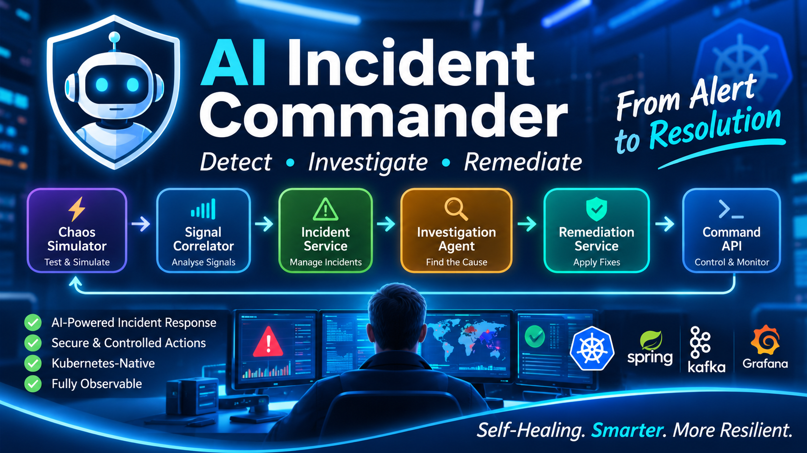
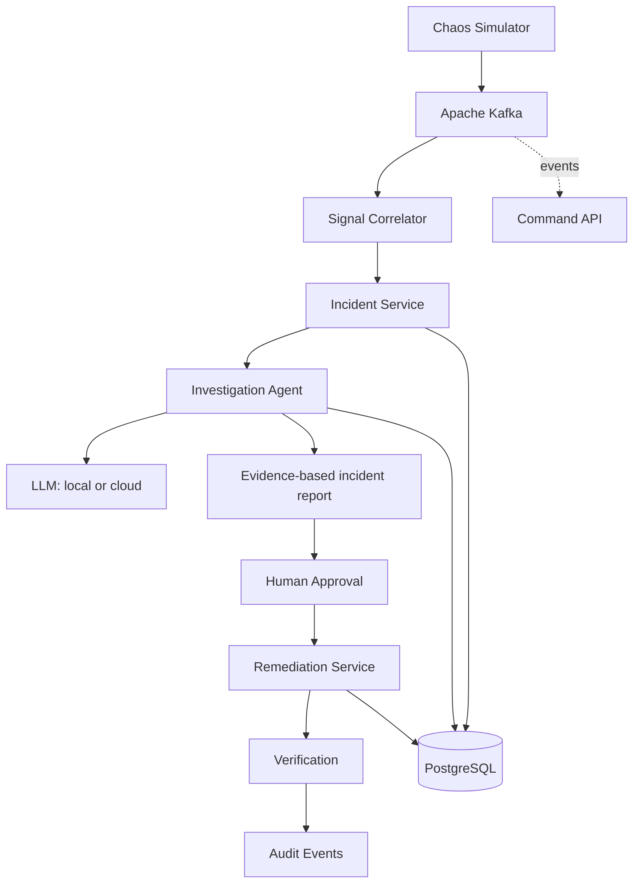

# AI Incident Commander

**An event-driven AI platform for automatically analysing, investigating, and resolving IT incidents.**

[](https://www.oracle.com/java/)
[](https://spring.io/projects/spring-boot)
[](https://kafka.apache.org/)
[](https://kubernetes.io/)
[](https://github.com/embabel)

## About this project

**AI Incident Commander** is an experimental platform demonstrating how modern Java technology, event-driven microservices, and AI agents can work together to detect, investigate, and resolve IT incidents in a controlled manner.

The platform simulates operational events such as increased error rates, latency issues, and failed deployments. Incidents are detected from these signals, after which an AI agent investigates possible causes, gathers evidence, and proposes remediation actions.

The solution is built around one key principle:

> **AI investigates and advises. Controlled automation executes. A human remains in control.**

The project demonstrates modern software architecture and engineering practices for cloud-native, event-driven, AI-assisted systems.



## Objectives

- Implement event-driven microservices using Java and Spring Boot.
- Provide asynchronous communication through Apache Kafka.
- Use AI agents to analyse and investigate incidents.
- Use Embabel for goal-oriented AI agent workflows.
- Support local language models and optional cloud-hosted LLMs.
- Run on Kubernetes using Helm.
- Integrate observability, tracing, metrics, and structured logging.
- Process remediation actions safely, audibly, and idempotently.
- Provide comprehensive automated tests and a reproducible demonstration.

## Architecture



### Main components

| Component | Responsibility |
|---|---|
| `chaos-simulator` | Generates simulated telemetry, infrastructure, and deployment events. |
| `signal-correlator` | Analyses signals and detects incidents using deterministic rules. |
| `incident-service` | Manages incidents, their statuses, and collected evidence. |
| `investigation-agent` | Investigates incidents using an AI agent and a language model. |
| `remediation-service` | Manages proposed remediation actions, approval, and controlled execution. |
| `command-api` | Provides an API for querying and managing incidents. |

Where possible, components communicate asynchronously through Kafka. This allows them to scale independently and handle failures and temporary interruptions in a controlled way.

## Technology stack

| Technology | Purpose |
|---|---|
| Java | Primary programming language |
| Spring Boot | Microservices and REST APIs |
| Gradle | Build and dependency management |
| Apache Kafka | Event-driven communication |
| Avro and Schema Registry | Event contract versioning and validation |
| Embabel | Goal-oriented AI agents |
| Spring AI | Language model integration |
| Ollama | Local language model execution |
| PostgreSQL | Persistent storage for incidents and investigation results |
| Kubernetes and Helm | Container orchestration and deployment |
| OpenTelemetry | Tracing and telemetry |
| Prometheus and Grafana | Metrics and dashboards |
| Testcontainers | Integration tests using real infrastructure components |

Exact dependency versions and compatibility are defined and tested as part of implementation.

## How it works

A demonstration scenario follows these steps:

1. **Simulate an incident** — for example, the simulator generates a sharp increase in HTTP 5xx errors following a deployment.
2. **Process signals** — the correlation service combines relevant events and detects a potential incident.
3. **Start an investigation** — an AI agent receives an investigation request containing the available incident data.
4. **Investigate the cause** — the agent analyses logs, metrics, deployment information, and other available evidence.
5. **Prepare a diagnosis** — the system produces a report containing a probable cause, supporting evidence, uncertainties, and recommended next steps.
6. **Request approval** — an authorised user reviews a proposed remediation action.
7. **Execute remediation** — the remediation service executes only permitted and approved actions.
8. **Verify the result** — new signals determine whether the incident has actually been resolved.
9. **Record the audit trail** — events, decisions, and execution results are stored in a traceable manner.

## AI and language models

The platform is designed to support both local and cloud-hosted language models.

- **Local:** Ollama supports experimentation and development without requiring an external LLM provider.
- **Cloud:** Optional integration with a compatible external model provider.
- **Agent orchestration:** Embabel for modelling and executing goal-oriented investigation workflows.
- **Integration:** Spring AI for model access and related AI functionality.

The AI agent is responsible for analysis and recommendations, not uncontrolled infrastructure changes. Investigation results should refer to concrete evidence sources wherever possible. The application independently validates proposed actions rather than trusting AI output.

## Security and reliability

Security is part of the design, not an afterthought.

- Remediation actions require explicit approval unless a separate, secure policy for automatic actions is implemented later.
- By default, the investigation agent has no write permissions on the Kubernetes cluster.
- Duplicate events must not create duplicate incidents or execute duplicate actions.
- Failures are handled using retries, dead-letter queues, and appropriate timeouts.
- Event processing and remediation actions are made idempotent where required.
- Important decisions and actions are recorded in an audit log.
- Sensitive data and credentials are not unnecessarily included in prompts or logs.
- Tests also cover unauthorised actions and invalid state transitions.

## Planned repository structure

```text
ai-incident-commander/
├── apps/
│   ├── chaos-simulator/
│   ├── signal-correlator/
│   ├── incident-service/
│   ├── investigation-agent/
│   ├── remediation-service/
│   └── command-api/
├── libs/
│   ├── event-contracts/
│   ├── observability-starter/
│   └── test-fixtures/
├── deploy/
│   ├── helm/
│   └── kind/
├── docs/
│   ├── architecture/
│   ├── adr/
│   ├── security/
│   └── runbooks/
├── scripts/
├── build.gradle
├── settings.gradle
├── compose.yaml
└── README.md
```

## Component documentation

This repository consists of separate services, libraries, and infrastructure-as-code modules. Each main component has its own README describing its responsibilities, architecture, technical implementation, and configuration. Together with this overview, these documents form the technical documentation for AI Incident Commander.

### Applications (`apps`)

| Component | Description | Documentation |
|---|---|---|
| Chaos Simulator | Generates controlled failures and incidents to test incident handling. | [apps/chaos-simulator/README.md](apps/chaos-simulator/README.md) |
| Signal Correlator | Collects and correlates technical signals into meaningful incidents. | [apps/signal-correlator/README.md](apps/signal-correlator/README.md) |
| Incident Service | Manages incidents, statuses, and their lifecycle. | [apps/incident-service/README.md](apps/incident-service/README.md) |
| Investigation Agent | Uses AI to analyse incidents and gather relevant diagnostic information. | [apps/investigation-agent/README.md](apps/investigation-agent/README.md) |
| Remediation Service | Manages controlled remediation actions and their execution. | [apps/remediation-service/README.md](apps/remediation-service/README.md) |
| Command API | Provides the API for orchestrating and managing incident response. | [apps/command-api/README.md](apps/command-api/README.md) |

### Libraries (`libs`)

| Component | Description | Documentation |
|---|---|---|
| Event Contracts | Shared event and message contracts used for communication between components. | [libs/event-contracts/README.md](libs/event-contracts/README.md) |

### Infrastructure as Code

| Component | Description | Documentation |
|---|---|---|
| Terraform Provisioning | Infrastructure provisioning and configuration for the required platform infrastructure. | [terraform/README.md](terraform/README.md) |

> **Note:** The Terraform README is included in this repository archive. Its content documents the Terraform configuration and its current implementation boundaries.

### Recommended reading order

For an end-to-end understanding of AI Incident Commander, the following reading order is recommended:

1. **Chaos Simulator** — understand how test signals and operational events are generated.
2. **Signal Correlator** — understand how signals are correlated and incidents detected.
3. **Incident Service** — understand incident persistence, evidence, and lifecycle management.
4. **Investigation Agent** — understand AI-assisted investigation and reporting.
5. **Remediation Service** — understand approval validation, controlled execution, and verification.
6. **Command API** — understand the operator-facing API.
7. **Event Contracts** — review the shared Kafka/Avro message definitions.
8. **Terraform** — review the infrastructure provisioning approach.

## Project status

This is an evolving engineering demonstration. Some integrations and production-hardening activities are intentionally identified as follow-up work in the component documentation. Do not interpret a documented target architecture as proof that every integration is already implemented or production-ready.
