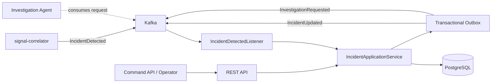

# incident-service

**Incident lifecycle, persistente opslag en bewijsbeheer** voor het AI Incident Commander-platform.

> AI onderzoekt en adviseert. Gecontroleerde automatisering voert uit. Een mens houdt de regie.

## Verantwoordelijkheid

De service ontvangt `IncidentDetected` vanuit `signal-correlator`, bewaart incidenten en bewijsreferenties in PostgreSQL, publiceert lifecycle-events en start een onderzoek door `InvestigationRequested` te publiceren. De REST API biedt incidentoverzicht, detail, bewijs, een expliciete onderzoeksaanvraag en gecontroleerde statusovergangen.

## Architectuur



## Technologie

- Java 25, Spring Boot 4.0.0, Gradle
- Spring Kafka, Apache Avro en Confluent Schema Registry
- PostgreSQL, Spring Data JPA en Flyway
- Actuator, Micrometer Prometheus
- JUnit 5, Spring Kafka Test en Testcontainers dependencies
- Docker en Helm

## Kafka-contracten

| Richting | Topic | Contract |
|---|---|---|
| In | `incident.detected.v1` | `IncidentDetected` |
| Uit | `incident.updated.v1` | `IncidentUpdated` |
| Uit | `incident.investigation.requested.v1` | `InvestigationRequested` |

De schema's in `src/main/resources/avro` zijn kopieën voor zelfstandig bouwen. De canonieke bron blijft `libs/event-contracts/src/main/avro` in de monorepo. Houd deze bestanden synchroon of vervang ze later door een gedeelde contract-artifact.

## REST API

| Methode | Endpoint | Doel |
|---|---|---|
| GET | `/api/v1/incidents` | Incidenten opvragen; optioneel `?status=NEW` |
| GET | `/api/v1/incidents/{id}` | Incidentdetail |
| GET | `/api/v1/incidents/{id}/evidence` | Bewijsreferenties |
| POST | `/api/v1/incidents/{id}/investigations` | Onderzoek aanvragen |
| PATCH | `/api/v1/incidents/{id}/status` | Statusovergang uitvoeren |

Voorbeeld onderzoeksaanvraag:

```http
POST /api/v1/incidents/{incidentId}/investigations
Content-Type: application/json

{"objective":"Onderzoek de oorzaak van de verhoogde 5xx-foutpercentages."}
```

Voorbeeld statuswijziging:

```http
PATCH /api/v1/incidents/{incidentId}/status
Content-Type: application/json

{"status":"INVESTIGATING","summary":"Onderzoek gestart door investigation-agent"}
```

De statusovergangen worden door het domeinmodel gevalideerd. Een `CLOSED` incident kan niet opnieuw worden geopend. Deze API is een interne service-API; authenticatie/autorisatie moet via de platformbeveiliging/API-gateway worden toegevoegd voordat deze extern beschikbaar wordt gemaakt.

## Betrouwbaarheid en veiligheid

- `processed_events` dedupliceert inkomende event-ID's.
- `incident_id` is de primaire sleutel; een tweede detectie voor hetzelfde incident maakt geen duplicaat.
- Incident, bewijs, inbox en outbox worden in dezelfde databasetransactie opgeslagen.
- Outbox-publicatie voorkomt dat een databasecommit en Kafka-publicatie los van elkaar verloren gaan.
- Outbox-publicatie is **at-least-once**: een crash na Kafka-ack maar vóór `published_at` kan een event opnieuw publiceren. Consumenten moeten daarom idempotent zijn.
- De service voert geen Kubernetes- of remediation-acties uit.
- Statusovergangen zijn expliciet toegestaan; een willekeurige statuswijziging wordt geweigerd.

## Configuratie

Belangrijkste environment variables:

| Variabele | Default |
|---|---|
| `SPRING_DATASOURCE_URL` | `jdbc:postgresql://localhost:5432/incidentdb` |
| `SPRING_DATASOURCE_USERNAME` | `incident` |
| `SPRING_DATASOURCE_PASSWORD` | `incident` |
| `SPRING_KAFKA_BOOTSTRAP_SERVERS` | `localhost:9092` |
| `SCHEMA_REGISTRY_URL` | `http://localhost:8081` |
| `INCIDENT_DETECTED_TOPIC` | `incident.detected.v1` |
| `INCIDENT_UPDATED_TOPIC` | `incident.updated.v1` |
| `INVESTIGATION_REQUESTED_TOPIC` | `incident.investigation.requested.v1` |
| `OUTBOX_POLL_DELAY_MS` | `1000` |

## Lokaal bouwen

Vereist Java 25 en Gradle:

```bash
gradle clean test
gradle bootJar
docker build -t incident-service:local .
```

Start daarnaast PostgreSQL, Kafka en Schema Registry. De database moet bestaan en de topics moeten beschikbaar zijn.

## Kubernetes

```bash
helm upgrade --install incident-service ./deploy/helm/incident-service \
  --set image.repository=incident-service \
  --set image.tag=local
```

Maak vooraf de Kubernetes Secret aan die in `values.yaml` is opgegeven.

## Tests

De code bevat unit-tests voor toegestane en verboden lifecycle-overgangen en een MVC-validatietest. Testcontainers-dependencies zijn opgenomen; volledige Kafka/PostgreSQL end-to-end-tests en concurrency-tests moeten nog worden toegevoegd.

## Bekende implementatiegrenzen

- Er is nog geen authenticatie/autorisatie in deze module zelf.
- De REST-lijst is bewust eenvoudig en nog niet gepagineerd.
- De outbox-publisher is een eerste werkbare implementatie; bij meerdere replicas is een claim/locking-strategie nodig om gelijktijdige verwerking te beperken.
- Retry-backoff, maximale retry-policy en dead-letter-afhandeling voor poison messages moeten in de deploymentconfiguratie worden afgemaakt.
- De listener verwerkt alleen `IncidentDetected`; resultaten van de investigation-agent worden via een volgende integratiestap gekoppeld.
- Schema's zijn lokaal gekopieerd en moeten bij contractwijzigingen synchroon blijven.

## Monorepo-integratie

Plaats de module onder `apps/incident-service`. De huidige build is standalone en gebruikt lokale schema-resourcebestanden. De monorepo kan later de gedeelde `libs/event-contracts` als Gradle-project dependency toevoegen.
