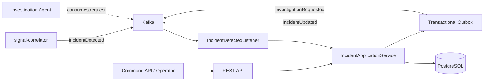

# Incident Service

**Incident lifecycle management, persistent storage, and evidence management** for the AI Incident Commander platform.

> AI investigates and advises. Controlled automation executes. A human remains in control.

## Responsibilities

The service receives `IncidentDetected` from `signal-correlator`, stores incidents and evidence references in PostgreSQL, publishes lifecycle events, and starts an investigation by publishing `InvestigationRequested`. The REST API provides incident listing, details, evidence, an explicit investigation request, and controlled status transitions.

## Architecture



## Technology

- Java 25, Spring Boot 4.0.0, Gradle
- Spring Kafka, Apache Avro, and Confluent Schema Registry
- PostgreSQL, Spring Data JPA, and Flyway
- Actuator, Micrometer Prometheus
- JUnit 5, Spring Kafka Test, and Testcontainers dependencies
- Docker and Helm

## Kafka contracts

| Direction | Topic | Contract |
|---|---|---|
| In | `incident.detected.v1` | `IncidentDetected` |
| Out | `incident.updated.v1` | `IncidentUpdated` |
| Out | `incident.investigation.requested.v1` | `InvestigationRequested` |

The schemas in `src/main/resources/avro` are copies used for standalone builds. The canonical source in the monorepo remains `libs/event-contracts/src/main/avro`. Keep these files synchronised or replace them later with a shared contract artifact.

## REST API

| Method | Endpoint | Purpose |
|---|---|---|
| GET | `/api/v1/incidents` | List incidents; optionally use `?status=NEW` |
| GET | `/api/v1/incidents/{id}` | Incident details |
| GET | `/api/v1/incidents/{id}/evidence` | Evidence references |
| POST | `/api/v1/incidents/{id}/investigations` | Request an investigation |
| PATCH | `/api/v1/incidents/{id}/status` | Apply a status transition |

Example investigation request:

```http
POST /api/v1/incidents/{incidentId}/investigations
Content-Type: application/json

{"objective":"Investigate the cause of the increased 5xx error rates."}
```

Example status change:

```http
PATCH /api/v1/incidents/{incidentId}/status
Content-Type: application/json

{"status":"INVESTIGATING","summary":"Investigation started by investigation-agent"}
```

Status transitions are validated by the domain model. A `CLOSED` incident cannot be reopened. This is an internal service API; authentication and authorisation must be added through platform security/API gateway controls before external exposure.

## Reliability and security

- `processed_events` deduplicates incoming event IDs.
- `incident_id` is the primary key; a second detection for the same incident does not create a duplicate.
- Incident, evidence, inbox, and outbox records are stored in the same database transaction.
- Outbox publishing prevents a database commit and Kafka publication from being lost independently.
- Outbox publishing is **at-least-once**: a crash after Kafka acknowledgement but before `published_at` may cause an event to be published again. Consumers must therefore be idempotent.
- The service does not perform Kubernetes or remediation actions.
- Only explicitly permitted status transitions are accepted; arbitrary status changes are rejected.

## Configuration

Main environment variables:

| Variable | Default |
|---|---|
| `SPRING_DATASOURCE_URL` | `jdbc:postgresql://localhost:5432/incidentdb` |
| `SPRING_DATASOURCE_USERNAME` | `incident` |
| `SPRING_DATASOURCE_PASSWORD` | `incident` |
| `SPRING_KAFKA_BOOTSTRAP_SERVERS` | `localhost:9092` |
| `SCHEMA_REGISTRY_URL` | `http://localhost:8081` |
| `INCIDENT_DETECTED_TOPIC` | `incident.detected.v1` |
| `INCIDENT_UPDATED_TOPIC` | `incident.updated.v1` |
| `INVESTIGATION_REQUESTED_TOPIC` | `incident.investigation.requested.v1` |
| `OUTBOX_POLL_DELAY_MS` | `1000` |

## Build locally

Requires Java 25 and Gradle:

```bash
gradle clean test
gradle bootJar
docker build -t incident-service:local .
```

Also start PostgreSQL, Kafka, and Schema Registry. The database must exist and the topics must be available.

## Kubernetes

```bash
helm upgrade --install incident-service ./deploy/helm/incident-service \
  --set image.repository=incident-service \
  --set image.tag=local
```

Create the Kubernetes Secret specified in `values.yaml` beforehand.

## Tests

The code includes unit tests for permitted and forbidden lifecycle transitions and an MVC validation test. Testcontainers dependencies are included; full Kafka/PostgreSQL end-to-end tests and concurrency tests still need to be added.

## Known implementation boundaries

- Authentication/authorisation is not yet implemented in this module.
- The REST list endpoint is intentionally simple and is not yet paginated.
- The outbox publisher is an initial implementation; with multiple replicas, a claiming/locking strategy is required to limit concurrent processing.
- Retry backoff, maximum retry policy, and dead-letter handling for poison messages still need to be completed in the deployment configuration.
- The listener processes only `IncidentDetected`; investigation-agent results will be integrated in a subsequent step.
- Schemas are copied locally and must remain synchronised when contracts change.

## Monorepo integration

Place the module under `apps/incident-service`. The current build is standalone and uses local schema resource files. The monorepo can later add the shared `libs/event-contracts` as a Gradle project dependency.
