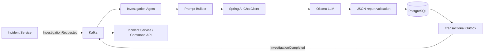

# investigation-agent

AI-onderzoekscomponent voor **AI Incident Commander**.

> AI onderzoekt en adviseert. Gecontroleerde automatisering voert uit. Een mens houdt de regie.

## Rol in de architectuur

De agent consumeert `InvestigationRequested`, bouwt een begrensde prompt met incidentcontext en bewijsreferenties, laat een lokaal Ollama-model een gestructureerd onderzoeksrapport opstellen en publiceert `InvestigationCompleted`.



## Technologie

- Java 25, Spring Boot 4.0.0, Gradle
- Spring AI ChatClient met Ollama
- Apache Kafka, Avro en Confluent Schema Registry
- PostgreSQL, Spring Data JPA en Flyway
- Actuator, Micrometer en Prometheus
- Docker, Helm, JUnit 5 en Testcontainers dependencies

## Topics en contracten

| Richting | Topic | Contract |
|---|---|---|
| In | `incident.investigation.requested.v1` | `InvestigationRequested` |
| Uit | `incident.investigation.completed.v1` | `InvestigationCompleted` |

De schema's in `src/main/resources/avro` zijn zelfstandige kopieën. De canonieke schema's horen in `libs/event-contracts/src/main/avro`; synchroniseer ze bij contractwijzigingen.

## Onderzoeksrapport

Het rapport bevat:
- samenvatting;
- waarschijnlijke root cause;
- conservatieve confidence-score;
- ondersteunende bewijsreferenties;
- onzekerheden en ontbrekende informatie;
- aanbevolen vervolgstappen;
- severity-inschatting;
- verplichte menselijke review.

## Belangrijke beperking van de huidige eventflow

De huidige `Incident Service` publiceert bewijs-ID's (`evidenceEventIds`), geen ruwe logs, metrics of deploymentdata. De agent behandelt deze daarom expliciet als referenties en mag niet beweren dat hij de onderliggende telemetry heeft onderzocht. Voor een inhoudelijk sterkere diagnose moet een volgende integratie gecontroleerde read-only evidence adapters toevoegen voor logs, metrics en deploymentmetadata.

## Veiligheidsmodel

- Geen Kubernetes-client, shell-tool of infrastructuur-write access.
- Het model geeft alleen advies; het voert geen remediation uit.
- Prompt bevat expliciete instructies tegen het verzinnen van bewijs.
- Rapport wordt als JSON gevalideerd en confidence wordt begrensd.
- Menselijke beoordeling staat altijd op `true`.
- Inkomende event-ID's worden idempotent verwerkt.
- Uitgaande events worden via een database-outbox gepubliceerd.

## Lokaal starten

Vereist Java 25, Gradle, PostgreSQL, Kafka, Schema Registry en Ollama.

```bash
ollama pull qwen2.5:7b
gradle clean test
gradle bootJar
docker build -t investigation-agent:local .
```

Stel de volgende omgevingsvariabelen in of gebruik de defaults uit `application.yml`:

- `SPRING_DATASOURCE_URL`
- `SPRING_DATASOURCE_USERNAME`
- `SPRING_DATASOURCE_PASSWORD`
- `SPRING_KAFKA_BOOTSTRAP_SERVERS`
- `SCHEMA_REGISTRY_URL`
- `OLLAMA_BASE_URL`
- `OLLAMA_MODEL`
- `INVESTIGATION_ENGINE=ollama`

Voor een deterministic fallback zonder LLM: `INVESTIGATION_ENGINE=fallback`.

## Kubernetes

Maak vooraf de Secret `investigation-agent-secrets` met de key `datasource-password` en configureer de infrastructuuradressen:

```bash
helm upgrade --install investigation-agent ./deploy/helm/investigation-agent
```

## Tests

Tests dekken promptveiligheid, promptlimieten en de fallback-engine. De dependencies voor Testcontainers zijn opgenomen; volledige integratietests met Kafka, PostgreSQL en Ollama moeten nog worden toegevoegd.

## Bekende grenzen / vervolgstappen

1. Voeg read-only adapters toe voor logs, metrics en deploymentinformatie.
2. Voeg Embabel toe voor expliciete goal-oriented agentorkestratie; de huidige uitvoeringslaag gebruikt Spring AI ChatClient rechtstreeks.
3. Voeg retry-backoff en een expliciete DLQ/poison-message policy toe.
4. Voeg schema-compatibiliteitstests toe tegen `libs/event-contracts`.
5. Stem het exacte `InvestigationCompleted`-contract af op `incident-service` en `command-api`.
6. Voeg autorisatie en tenant-/environment-scoping toe aan evidence retrieval.

De agent heeft geen automatische bevoegdheid om herstelacties uit te voeren.
