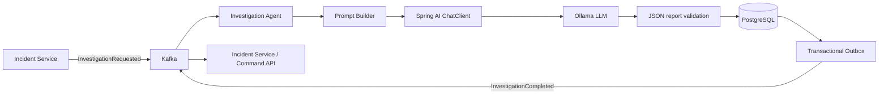

# Investigation Agent

AI investigation component for **AI Incident Commander**.

> AI investigates and advises. Controlled automation executes. A human remains in control.

## Role in the architecture

The agent consumes `InvestigationRequested`, builds a bounded prompt containing incident context and evidence references, asks a local Ollama model to generate a structured investigation report, and publishes `InvestigationCompleted`.



## Technology

- Java 25, Spring Boot 4.0.0, Gradle
- Spring AI ChatClient with Ollama
- Apache Kafka, Avro, and Confluent Schema Registry
- PostgreSQL, Spring Data JPA, and Flyway
- Actuator, Micrometer, and Prometheus
- Docker, Helm, JUnit 5, and Testcontainers dependencies

## Topics and contracts

| Direction | Topic | Contract |
|---|---|---|
| In | `incident.investigation.requested.v1` | `InvestigationRequested` |
| Out | `incident.investigation.completed.v1` | `InvestigationCompleted` |

The schemas in `src/main/resources/avro` are standalone copies. The canonical schemas belong in `libs/event-contracts/src/main/avro`; synchronise them whenever contracts change.

## Investigation report

The report contains:
- Summary
- Probable root cause
- Conservative confidence score
- Supporting evidence references
- Uncertainties and missing information
- Recommended next steps
- Severity assessment
- Mandatory human review

## Important limitation of the current event flow

The current `Incident Service` publishes evidence IDs (`evidenceEventIds`), not raw logs, metrics, or deployment data. The agent therefore treats them explicitly as references and must not claim to have inspected the underlying telemetry. A subsequent integration should add controlled, read-only evidence adapters for logs, metrics, and deployment metadata to produce stronger diagnoses.

## Security model

- No Kubernetes client, shell tool, or infrastructure write access.
- The model provides recommendations only; it does not execute remediation.
- The prompt includes explicit instructions not to fabricate evidence.
- The report is validated as JSON and the confidence score is bounded.
- Human review is always set to `true`.
- Incoming event IDs are processed idempotently.
- Outgoing events are published through a database outbox.

## Run locally

Requires Java 25, Gradle, PostgreSQL, Kafka, Schema Registry, and Ollama.

```bash
ollama pull qwen2.5:7b
gradle clean test
gradle bootJar
docker build -t investigation-agent:local .
```

Set the following environment variables or use the defaults in `application.yml`:

- `SPRING_DATASOURCE_URL`
- `SPRING_DATASOURCE_USERNAME`
- `SPRING_DATASOURCE_PASSWORD`
- `SPRING_KAFKA_BOOTSTRAP_SERVERS`
- `SCHEMA_REGISTRY_URL`
- `OLLAMA_BASE_URL`
- `OLLAMA_MODEL`
- `INVESTIGATION_ENGINE=ollama`

For a deterministic fallback without an LLM, set `INVESTIGATION_ENGINE=fallback`.

## Kubernetes

Create the `investigation-agent-secrets` Secret beforehand with the `datasource-password` key and configure the infrastructure addresses:

```bash
helm upgrade --install investigation-agent ./deploy/helm/investigation-agent
```

## Tests

Tests cover prompt safety, prompt limits, and the fallback engine. Testcontainers dependencies are included; full integration tests with Kafka, PostgreSQL, and Ollama still need to be added.

## Known boundaries and next steps

1. Add read-only adapters for logs, metrics, and deployment information.
2. Add Embabel for explicit goal-oriented agent orchestration; the current execution layer uses Spring AI ChatClient directly.
3. Add retry backoff and an explicit DLQ/poison-message policy.
4. Add schema compatibility tests against `libs/event-contracts`.
5. Align the exact `InvestigationCompleted` contract with `incident-service` and `command-api`.
6. Add authorisation and tenant/environment scoping to evidence retrieval.

The agent has no automatic authority to execute remediation actions.
