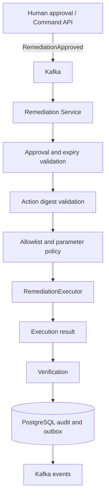

# remediation-service

De gecontroleerde uitvoeringscomponent van **AI Incident Commander**.

> AI onderzoekt en adviseert. Gecontroleerde automatisering voert uit. Een mens houdt de regie.

## Rol in de architectuur

De service ontvangt een `RemediationApproved`-event. Vóór uitvoering controleert hij de goedkeuring, geldigheidsperiode, namespace, actietype, parameters en digest van de exact goedgekeurde actie. Daarna roept hij een begrensde `RemediationExecutor` aan, registreert het resultaat en publiceert events via een database-outbox.



## Technologie

- Java 25, Spring Boot 4.0.0, Gradle
- Apache Kafka, Avro en Confluent Schema Registry
- PostgreSQL, Spring Data JPA en Flyway
- Actuator, Micrometer en Prometheus
- Docker, Helm, JUnit 5 en Testcontainers dependencies

## Kafka-topics

| Richting | Topic | Event |
|---|---|---|
| In | `incident.remediation.approved.v1` | `RemediationApproved` |
| In | `incident.remediation.rejected.v1` | `RemediationRejected` |
| Uit | `incident.remediation.executed.v1` | `RemediationExecuted` |
| Uit | `incident.remediation.failed.v1` | `RemediationFailed` |
| Uit | `incident.remediation.verified.v1` | `RemediationVerified` |

De schema's in `src/main/resources/avro` zijn zelfstandige lokale kopieën. De canonieke contracten horen in `libs/event-contracts/src/main/avro`. Vergelijk en synchroniseer ze vóór monorepo-integratie; de eventvelden in deze module zijn een voorgestelde interface en niet automatisch bewijs dat de bestaande canonieke schema's identiek zijn.

## Allowlist en policy

Ondersteunde actietypen:

- `RESTART_WORKLOAD` — geen parameters
- `SCALE_WORKLOAD` — replica-aantal 1 t/m 5
- `ROLLBACK_DEPLOYMENT` — positieve revision

Namespaces zijn configureerbaar; standaard `default,demo`. Resource-namen worden gevalideerd. Onbekende actietypen en parameters worden geweigerd.

## Approval digest

De service berekent SHA-256 over `proposalId`, `incidentId`, `actionType`, `resourceId`, `namespace` en parameters (gesorteerd op sleutel). Deze digest moet exact overeenkomen met `approvedActionDigest`. De producer van het approval-event moet dezelfde canonicalisatie implementeren. Leg dit formaat vast als gedeeld contract en test het vanuit Command API.

## Veiligheidsmodel

**Standaard staat `REMEDIATION_EXECUTION_MODE=simulation`.** De meegeleverde `SimulationRemediationExecutor` voert geen clusterwijzigingen uit. Er is bewust geen Kubernetes-client of shell-executor opgenomen.

`RemediationExecutor` is een SPI voor een later, afzonderlijk beveiligd uitvoeringsadapter. Een productieadapter moet minimaal:

- uitsluitend allowlisted handelingen implementeren;
- een dedicated service account met minimale RBAC gebruiken;
- namespace- en resource-scoping afdwingen;
- geen arbitraire commando's, manifests of image-velden accepteren;
- rate limits, timeouts, audit logging en een kill switch ondersteunen.

Verificatie staat standaard op `manual`. De service publiceert dan `UNVERIFIED`; dit is nadrukkelijk geen succesmelding. Voeg automatische verificatie pas toe na integratie met betrouwbare read-only observability-data.

## Lokaal bouwen en starten

Vereist Java 25, Gradle, PostgreSQL, Kafka en Schema Registry.

```bash
gradle clean test
gradle bootJar
docker build -t remediation-service:local .
```

Belangrijke variabelen:

- `SPRING_DATASOURCE_URL`, `SPRING_DATASOURCE_USERNAME`, `SPRING_DATASOURCE_PASSWORD`
- `SPRING_KAFKA_BOOTSTRAP_SERVERS`, `SCHEMA_REGISTRY_URL`
- `REMEDIATION_EXECUTION_MODE=simulation`
- `REMEDIATION_VERIFICATION_MODE=manual`
- `REMEDIATION_ALLOWED_NAMESPACES=default,demo`

## REST API

- `GET /api/v1/remediations` — laatste 100 uitvoeringsrecords
- `GET /api/v1/remediations/{proposalId}` — detail van één voorstel

Er is bewust geen REST-endpoint om een actie uit te voeren of goed te keuren. Uitvoering start uitsluitend via een goedgekeurd Kafka-event.

## Kubernetes

Maak vooraf de Secret `remediation-service-secrets` met key `datasource-password`.

```bash
helm upgrade --install remediation-service ./deploy/helm/remediation-service
```

## Tests

Unit tests dekken digest-stabiliteit, wijzigingen aan parameters, allowlist, namespace-policy, schaalgrenzen en verlopen goedkeuringen. Volledige integratietests met Kafka en PostgreSQL moeten nog worden toegevoegd.

## Productie-aandachtspunten

1. Stem event-schema's exact af op `libs/event-contracts`.
2. Voeg authenticatie en autorisatie toe aan read-only REST-endpoints.
3. Voeg outbox-claiming/locking toe voor meerdere replicas; huidige publisher is bedoeld voor één replica.
4. Voeg retry/backoff, poison-message-afhandeling en DLQ toe.
5. Maak idempotency en exactly-once-effecten ook in de uitvoeringsadapter hard.
6. Implementeer een onafhankelijke read-only verifier.
7. Bouw en test de monorepo-integratie voordat echte clusterrechten worden toegekend.

**Belangrijk:** deze codebase draait standaard veilig in simulatiemodus. Geef geen productieclusterrechten voordat uitvoeringsadapter, RBAC, schema's, approval digest en integratietests onafhankelijk zijn beoordeeld.
