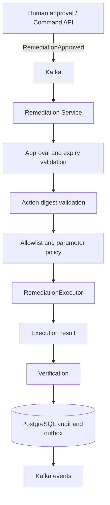

# Remediation Service

The controlled execution component of **AI Incident Commander**.

> AI investigates and advises. Controlled automation executes. A human remains in control.

## Role in the architecture

The service receives a `RemediationApproved` event. Before execution, it validates the approval, expiry period, namespace, action type, parameters, and digest of the exact approved action. It then invokes a bounded `RemediationExecutor`, records the result, and publishes events through a database outbox.



## Technology

- Java 25, Spring Boot 4.0.0, Gradle
- Apache Kafka, Avro, and Confluent Schema Registry
- PostgreSQL, Spring Data JPA, and Flyway
- Actuator, Micrometer, and Prometheus
- Docker, Helm, JUnit 5, and Testcontainers dependencies

## Kafka topics

| Direction | Topic | Event |
|---|---|---|
| In | `incident.remediation.approved.v1` | `RemediationApproved` |
| In | `incident.remediation.rejected.v1` | `RemediationRejected` |
| Out | `incident.remediation.executed.v1` | `RemediationExecuted` |
| Out | `incident.remediation.failed.v1` | `RemediationFailed` |
| Out | `incident.remediation.verified.v1` | `RemediationVerified` |

The schemas in `src/main/resources/avro` are standalone local copies. The canonical contracts belong in `libs/event-contracts/src/main/avro`. Compare and synchronise them before monorepo integration; the event fields in this module are a proposed interface and do not automatically prove that the existing canonical schemas are identical.

## Allowlist and policy

Supported action types:

- `RESTART_WORKLOAD` — no parameters
- `SCALE_WORKLOAD` — replica count from 1 to 5
- `ROLLBACK_DEPLOYMENT` — positive revision

Namespaces are configurable; the defaults are `default,demo`. Resource names are validated. Unknown action types and parameters are rejected.

## Approval digest

The service calculates SHA-256 over `proposalId`, `incidentId`, `actionType`, `resourceId`, `namespace`, and parameters (sorted by key). This digest must exactly match `approvedActionDigest`. The approval-event producer must implement the same canonicalisation. Define this format as a shared contract and test it from Command API.

## Security model

**`REMEDIATION_EXECUTION_MODE=simulation` is the default.** The included `SimulationRemediationExecutor` does not make cluster changes. No Kubernetes client or shell executor is intentionally included.

`RemediationExecutor` is an SPI for a future, separately secured execution adapter. A production adapter must at a minimum:

- Implement only allowlisted operations.
- Use a dedicated service account with minimal RBAC permissions.
- Enforce namespace and resource scoping.
- Reject arbitrary commands, manifests, or image fields.
- Support rate limits, timeouts, audit logging, and a kill switch.

Verification defaults to `manual`. In this mode, the service publishes `UNVERIFIED`; this is explicitly not a success indication. Add automatic verification only after integration with reliable read-only observability data.

## Build and run locally

Requires Java 25, Gradle, PostgreSQL, Kafka, and Schema Registry.

```bash
gradle clean test
gradle bootJar
docker build -t remediation-service:local .
```

Important variables:

- `SPRING_DATASOURCE_URL`, `SPRING_DATASOURCE_USERNAME`, `SPRING_DATASOURCE_PASSWORD`
- `SPRING_KAFKA_BOOTSTRAP_SERVERS`, `SCHEMA_REGISTRY_URL`
- `REMEDIATION_EXECUTION_MODE=simulation`
- `REMEDIATION_VERIFICATION_MODE=manual`
- `REMEDIATION_ALLOWED_NAMESPACES=default,demo`

## REST API

- `GET /api/v1/remediations` — latest 100 execution records
- `GET /api/v1/remediations/{proposalId}` — details for a proposal

There is intentionally no REST endpoint for executing or approving an action. Execution starts only through an approved Kafka event.

## Kubernetes

Create the `remediation-service-secrets` Secret beforehand with the `datasource-password` key.

```bash
helm upgrade --install remediation-service ./deploy/helm/remediation-service
```

## Tests

Unit tests cover digest stability, parameter changes, allowlists, namespace policy, scaling limits, and expired approvals. Full integration tests with Kafka and PostgreSQL still need to be added.

## Production considerations

1. Align event schemas exactly with `libs/event-contracts`.
2. Add authentication and authorisation to the read-only REST endpoints.
3. Add outbox claiming/locking for multiple replicas; the current publisher is intended for a single replica.
4. Add retry/backoff, poison-message handling, and a DLQ.
5. Enforce idempotency and exactly-once effects in the execution adapter as well.
6. Implement an independent read-only verifier.
7. Build and test monorepo integration before granting real cluster permissions.

**Important:** this codebase runs safely in simulation mode by default. Do not grant production cluster permissions until the execution adapter, RBAC, schemas, approval digest, and integration tests have been independently reviewed.
