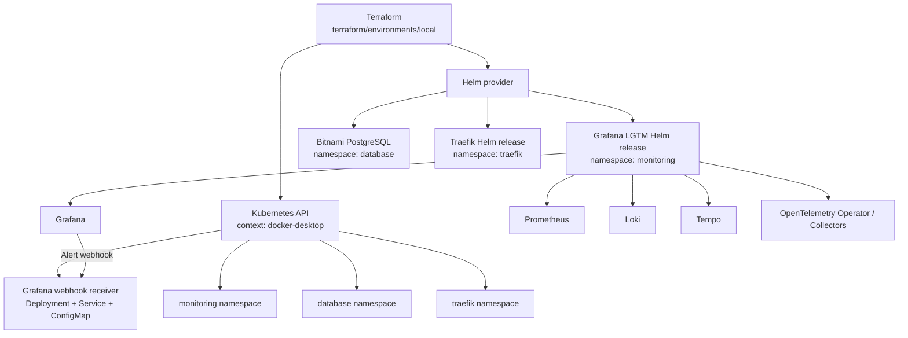
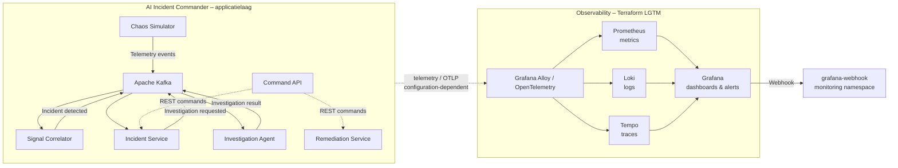
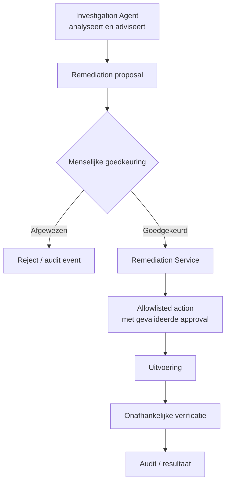
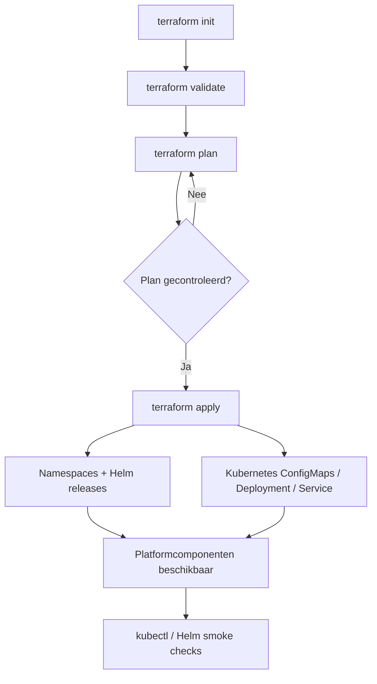

# Terraform Provisioning – AI Incident Commander

[](https://developer.hashicorp.com/terraform)
[](https://kubernetes.io/)
[](https://helm.sh/)
[](https://grafana.com/)

> **Terraform provisioneert de platforminfrastructuur; Kubernetes en Helm hosten de services. AI onderzoekt en adviseert. Gecontroleerde automatisering voert uit. Een mens houdt de regie.**

Deze directory bevat de Terraform-configuratie voor het provisioneren van onderdelen van de infrastructuur waarop **AI Incident Commander** kan draaien. De huidige configuratie is gericht op een lokale Kubernetes-omgeving (Docker Desktop-context) en bevat herbruikbare modules voor observability, PostgreSQL, Traefik, een Grafana-webhookreceiver en FluxCD-bootstrap.

De README beschrijft wat er daadwerkelijk in deze directory staat. Onderdelen die wel als module aanwezig zijn maar nog niet vanuit de lokale environment worden aangeroepen, worden expliciet als zodanig aangeduid.

---

## Inhoudsopgave

- [1. Doel en scope](#1-doel-en-scope)
- [2. Platformarchitectuur](#2-platformarchitectuur)
- [3. Relatie met de applicatieservices](#3-relatie-met-de-applicatieservices)
- [4. Terraform-directorystructuur](#4-terraform-directorystructuur)
- [5. Provisioning-overzicht](#5-provisioning-overzicht)
- [6. Terraform-modules](#6-terraform-modules)
- [7. Lokale environment](#7-lokale-environment)
- [8. Configuratie en secrets](#8-configuratie-en-secrets)
- [9. Installatie en gebruik](#9-installatie-en-gebruik)
- [10. Verificatie en troubleshooting](#10-verificatie-en-troubleshooting)
- [11. Security en operationele aandachtspunten](#11-security-en-operationele-aandachtspunten)
- [12. Huidige status en vervolgstappen](#12-huidige-status-en-vervolgstappen)

---

## 1. Doel en scope

Terraform wordt gebruikt om infrastructuurcomponenten reproduceerbaar te declareren en te beheren. De configuratie maakt gebruik van:

- **Terraform** voor declaratieve infrastructuurdefinities.
- **Kubernetes provider** voor namespaces, ConfigMaps, Deployments en Services.
- **Helm provider** voor het installeren van Kubernetes-platformcomponenten.
- **Helm charts** voor onder andere Grafana LGTM, PostgreSQL en Traefik.
- **FluxCD provider en GitHub provider** in de FluxCD-module voor GitOps-bootstrap.
- **TLS provider** voor het genereren van een SSH deploy key voor FluxCD.

### Wat valt binnen deze directory?

| Onderdeel | In de repository aanwezig | Aangeroepen door `environments/local` |
|---|---:|---:|
| Grafana LGTM-stack | Ja | Ja |
| PostgreSQL | Ja | Ja |
| Traefik ingress controller | Ja | Ja |
| Grafana webhook receiver | Ja | Ja |
| Grafana Alloy standalone-stack | Ja | Nee |
| FluxCD/GitHub bootstrap | Ja | Nee; bootstrap-resource is bovendien uitgecommentarieerd |
| MongoDB-module | Niet aangetroffen | Nee |
| Qdrant-module | Niet aangetroffen | Nee |

**Belangrijk:** Terraform provisioneert in de huidige lokale root-configuratie niet automatisch alle applicatieservices. De applicaties zelf staan onder `apps/` en hebben eigen container- en Helm-deploymentbestanden. De Terraform-configuratie richt zich op platformcomponenten en ondersteunende infrastructuur.

## 2. Platformarchitectuur

### 2.1 Infrastructure provisioning

Onderstaand diagram geeft de feitelijke relaties weer die in `terraform/environments/local/main.tf` zijn gedeclareerd.



### 2.2 Observability en incident response

De applicatiearchitectuur genereert en verwerkt events via Kafka. De observability-stack verzamelt metrics, logs en traces om de applicaties operationeel inzichtelijk te maken. Grafana-alerts kunnen naar de in-cluster webhookreceiver worden gestuurd.



Het tweede diagram toont de beoogde samenhang op platformniveau. De exacte OTLP-endpoints, exporterconfiguratie en instrumentatie per applicatie moeten in de applicatieconfiguratie en Kubernetes-deployments overeenkomen met de daadwerkelijk uitgerolde observability-stack.

### 2.3 LGTM-componenten

| Component | Rol |
|---|---|
| Grafana | Dashboards, visualisatie en alerting |
| Prometheus | Metrics-opslag en PromQL-query's |
| Loki | Centrale opslag en query's voor logs |
| Tempo | Distributed tracing |
| OpenTelemetry Operator | Beheer van OpenTelemetry Collector-resources |
| OpenTelemetry Collector(s) | Ontvangst en verwerking van telemetry |
| Grafana Alloy | Collector/distributiecomponent in de afzonderlijke `alloy`-module |

De lokale environment gebruikt de `grafana-stack`-module. De zelfstandige `alloy`-module is aanwezig, maar wordt niet vanuit de huidige lokale `main.tf` aangeroepen. Gebruik beide stacks niet zonder eerst de gewenste ownership en eventuele overlap van Prometheus, Loki, Tempo en collectors te bepalen.

## 3. Relatie met de applicatieservices

AI Incident Commander bestaat uit zes applicatieservices. Hun functionele rollen zijn:

| Service | Verantwoordelijkheid | Infrastructuurrelatie |
|---|---|---|
| `chaos-simulator` | Genereert gesimuleerde telemetry en verstoringen | Publiceert events naar Kafka; telemetry kan door observability worden verzameld |
| `signal-correlator` | Correlatie van signalen en deterministische incidentdetectie | Kafka-consumer/producer; metrics en logs |
| `incident-service` | Incident lifecycle, status en bewijsregistratie | PostgreSQL voor persistente incidentgegevens; Kafka voor events |
| `investigation-agent` | AI-onderzoek en rapportage | LLM-provider (bijvoorbeeld lokaal Ollama, afhankelijk van deployment); PostgreSQL/Kafka |
| `remediation-service` | Valideert goedgekeurde herstelacties en voert toegestane acties uit | PostgreSQL/Kafka; Kubernetes-rechten moeten minimaal en expliciet worden ingericht |
| `command-api` | REST-interface voor incidentbeheer en commando's | Communiceert met downstream services via de geconfigureerde service-URL's |

**Let op:** de Terraform environment in deze directory declareert momenteel geen Kafka-, Ollama-, MongoDB- of Qdrant-module en declareert ook niet de Helm releases van de zes applicatieservices. Deze componenten kunnen via andere deploymentbestanden of externe infrastructuur worden geleverd; ze worden niet door de hier getoonde lokale Terraform-root geprovisioneerd.

### 3.1 Menselijke controle bij remediation



Terraform-infrastructuur verleent op zichzelf geen toestemming om herstelacties uit te voeren. Kubernetes RBAC, service accounts, secrets en netwerktoegang moeten afzonderlijk en least-privilege worden ingericht. De AI-agent hoort geen standaard schrijfrechten op het cluster te krijgen.

## 4. Terraform-directorystructuur

```text
terraform/
├── environments/
│   └── local/
│       ├── backend.tf
│       ├── main.tf
│       ├── outputs.tf
│       ├── providers.tf
│       ├── variables.tf
│       └── terraform.auto.tfvars
│
└── modules/
    ├── alloy/
    │   ├── main.tf
    │   ├── variables.tf
    │   ├── outputs.tf
    │   ├── versions.tf
    │   └── *.yaml.tpl / *.river.tpl
    │
    ├── fluxcd/
    │   ├── main.tf
    │   ├── variables.tf
    │   ├── outputs.tf
    │   └── versions.tf
    │
    ├── grafana-stack/
    │   ├── main.tf
    │   ├── variables.tf
    │   ├── outputs.tf
    │   ├── versions.tf
    │   └── otel-metrics-patch.yaml
    │
    ├── grafana-webhook-receiver/
    │   ├── main.tf
    │   ├── variables.tf
    │   ├── outputs.tf
    │   └── versions.tf
    │
    ├── postgresql/
    │   ├── main.tf
    │   ├── variables.tf
    │   ├── outputs.tf
    │   ├── versions.tf
    │   └── values.yaml
    │
    └── traefik/
        ├── main.tf
        ├── variables.tf
        ├── outputs.tf
        ├── versions.tf
        └── values.yaml.tpl
```

### Environment versus module

- `environments/local` is de root module: hier worden providers geconfigureerd en modules met concrete waarden aangeroepen.
- `modules/*` bevat herbruikbare infrastructuurblokken.
- `*.yaml.tpl` en `*.river.tpl` zijn templates die door Terraform worden ingevuld.
- `backend.tf` gebruikt momenteel een lokale Terraform statefile.

## 5. Provisioning-overzicht

De huidige `environments/local/main.tf` declareert vier modules:

1. `grafana-stack` in namespace `monitoring`.
2. `postgresql` met release `notebook-postgresql` in namespace `database`.
3. `traefik` in namespace `traefik`.
4. `grafana-webhook-receiver` in namespace `monitoring`.

De dependencyrelaties binnen de modules bepalen de volgorde van onderliggende resources. Terraform kan onafhankelijke modules parallel uitvoeren.



## 6. Terraform-modules

### 6.1 `grafana-stack`

**Doel:** installatie van een samengestelde Grafana LGTM-stack via de PromptlyLabs Helm chart.

De module:

- Maakt de opgegeven namespace aan (in de lokale environment: `monitoring`).
- Installeert `cert-manager` (standaard versie `v1.18.2`).
- Installeert de OpenTelemetry Operator (standaard chartversie `0.122.1`).
- Installeert de `lgtm` Helm chart.
- Configureert Grafana, Prometheus, Loki en Tempo via Helm values.
- Schakelt de ingebouwde OpenTelemetry Operator in de umbrella chart uit, omdat de operator apart wordt geïnstalleerd.
- Configureert Tempo metrics generation en remote-write richting de opgegeven Prometheus service-URL.
- Genereert een patchbestand voor de OpenTelemetry Collector metrics pipeline.
- Maakt een ConfigMap met Grafana contact point en notification policy voor de lokale webhookreceiver.

Belangrijke variabelen:

| Variabele | Betekenis |
|---|---|
| `namespace` | Namespace voor de observability-stack |
| `chart_version` | LGTM chartversie |
| `grafana_admin_password` | Grafana admin-wachtwoord (sensitive) |
| `persistence_enabled` | In-/uitschakelen van persistente opslag |
| `persistence_size` | Opslaggrootte |
| `prometheus_service_url` | Prometheus remote-write endpoint |
| `custom_values` | Aanvullende Helm values |

Output: `helm_release_status` en `grafana_service_url`.

**Patch-aandachtspunt:** de module gebruikt een `local-exec` provisioner met PowerShell om een OpenTelemetryCollector-resource te patchen via `kubectl`. Dit vereist PowerShell, een werkende kubeconfig en een passend collector-resourceobject in de cluster. Controleer ook dat het patchbestand dat door de provisioner wordt gebruikt overeenkomt met de gegenereerde patch. De provisioner is niet volledig platformonafhankelijk.

### 6.2 `postgresql`

**Doel:** PostgreSQL installeren met de Bitnami Helm chart.

De lokale environment configureert:

- Helm release: `notebook-postgresql`
- Namespace: `database`
- Chartversie: `18.12.1`
- Database: `notebook`
- Gebruiker: `notebook`
- Persistent storage: `8Gi`

De wachtwoordwaarde komt uit `var.postgres_password` en wordt als sensitive gedeclareerd.

De module-output bevat servicegegevens. Controleer vóór applicatie-integratie de service-DNS-naam en databaseconfiguratie: de huidige output `connection_host` verwijst naar `mongodb.${var.namespace}.svc.cluster.local`, terwijl de release en service PostgreSQL betreffen. Dit lijkt een achtergebleven hostnaam en moet worden gecorrigeerd voordat applicaties deze output gebruiken.

### 6.3 `traefik`

**Doel:** Traefik als Kubernetes ingress/controller installeren via Helm.

Lokale configuratie:

- Namespace: `traefik`
- Replica's: `1`
- Metrics: uitgeschakeld
- Chartversie in module: `38.0.2`

De chartwaarden configureren access logs en topology spread constraints. Metrics en ServiceMonitor kunnen via `enable_metrics` worden ingeschakeld.

De module maakt een namespace aan en installeert de Helm release `traefik-nginx`. Controleer de daadwerkelijke Service- en LoadBalancer/NodePort-configuratie voordat externe toegang tot applicaties wordt verwacht; de module-output geeft momenteel alleen namespace en release name terug.

### 6.4 `grafana-webhook-receiver`

**Doel:** een eenvoudige HTTP-webhookreceiver binnen Kubernetes beschikbaar maken voor Grafana-alerts.

De module maakt:

- Een ConfigMap met een kleine Python HTTP-server.
- Een Deployment met readiness- en liveness-probes.
- Een ClusterIP Service.
- Een `/health` endpoint en een `/webhook` POST endpoint.

Defaults:

| Instelling | Waarde |
|---|---|
| Namespace | `monitoring` |
| Deployment/Service naam | `grafana-webhook` |
| Image | `python:3.12-alpine` |
| Port | `8080` |
| Replicas | `1` |

De receiver logt het ontvangen JSON-payload en retourneert `{"status":"received"}`. Dit is een demonstratie-/integratie-endpoint; het verwerkt nog geen incidentcommando's en voert geen remediation uit.

### 6.5 `alloy`

**Doel:** alternatieve, zelfstandige observability-installatie met afzonderlijke Helm releases voor Loki, Tempo, Prometheus (`kube-prometheus-stack`) en Grafana Alloy.

De module genereert Alloy-configuratie via templates en configureert endpoints voor Loki, Tempo en Prometheus remote write.

**Status:** de module bestaat, maar wordt niet aangeroepen in `environments/local/main.tf`. De lokale environment gebruikt `grafana-stack`. Bepaal eerst welke observability-architectuur leidend moet zijn voordat deze module wordt geactiveerd; anders kunnen dubbele releases en overlappende collectors ontstaan.

### 6.6 `fluxcd`

**Doel:** bootstrap van FluxCD voor GitOps-synchronisatie met een GitHub-repository.

De module bevat resources voor:

- Een ECDSA P-384 private key via de TLS provider.
- Optioneel aanmaken van een GitHub repository.
- Een GitHub deploy key.
- Flux provider configuratie voor bootstrap en extra controllers.

De documentatie in de module beschrijft een Image Automation workflow waarbij Flux image tags volgt, Git-manifests bijwerkt en de clusterreconciliatie uitvoert.

**Status en belangrijke beperking:** de `flux_bootstrap_git` resource in `modules/fluxcd/main.tf` staat momenteel binnen een block comment en wordt dus niet uitgevoerd. De module wordt bovendien niet vanuit de lokale environment aangeroepen. De GitHub repository/deploy-key resources zijn daarom niet gelijk aan een actieve FluxCD bootstrap. Voor activering moeten de provider credentials, repository, deploy-key-permissies en bootstrap-resource bewust worden ingericht.

## 7. Lokale environment

De lokale providerconfiguratie gebruikt:

- Kubernetes context: `docker-desktop`
- Kubeconfig: `~/.kube/config`
- Helm provider met dezelfde Kubernetes context
- Grafana provider met `grafana_url` en `grafana_token`

Pas `config_context` aan wanneer je bijvoorbeeld `kind`, `minikube` of een andere Kubernetes-context gebruikt.

### Benodigdheden

- Terraform `>= 1.9`
- Docker Desktop met Kubernetes ingeschakeld, of een compatibele lokale Kubernetes-cluster
- `kubectl` met een werkende kubeconfig
- Helm
- PowerShell wanneer de LGTM patch-provisioner wordt uitgevoerd
- Toegang tot de gebruikte Helm repositories/OCI registry

## 8. Configuratie en secrets

De environment bevat `terraform.auto.tfvars`. In de aangeleverde repository bevat dit bestand voorbeeldwaarden zoals `notebook`, `admin` en `xxxx`. Gebruik deze waarden uitsluitend als lokale placeholders en niet voor een gedeelde of productieomgeving.

**Aanbevolen werkwijze:**

1. Commit geen echte wachtwoorden, tokens of private keys.
2. Voeg lokale `*.tfvars`-bestanden met secrets toe aan `.gitignore`.
3. Gebruik een apart `terraform.tfvars.example` met uitsluitend niet-geheime placeholders.
4. Lever secrets aan via environment variables (`TF_VAR_*`) of een secret manager.
5. Beperk toegang tot Terraform state; `sensitive = true` maskeert output maar versleutelt state niet.
6. Roteer eventuele credentials die ooit in een publieke of gedeelde repository zijn terechtgekomen.

Voorbeeld van variabelen via de shell:

```bash
export TF_VAR_postgres_password='use-a-secret-manager'
export TF_VAR_grafana_admin_password='use-a-secret-manager'
export TF_VAR_grafana_token='use-a-secret-manager'
```

Op PowerShell:

```powershell
$env:TF_VAR_postgres_password = "use-a-secret-manager"
$env:TF_VAR_grafana_admin_password = "use-a-secret-manager"
$env:TF_VAR_grafana_token = "use-a-secret-manager"
```

De variabelen `grafana_url`, `grafana_token` en `prometheus_service_url` moeten overeenkomen met de daadwerkelijk bereikbare services. De Grafana provider kan pas succesvol authenticeren wanneer de opgegeven Grafana-instance bereikbaar is.

## 9. Installatie en gebruik

Voer de commando's uit vanuit `terraform/environments/local`.

### 9.1 Kubernetes-context controleren

```bash
kubectl config current-context
kubectl cluster-info
kubectl get nodes
```

De huidige providerconfiguratie verwacht `docker-desktop`.

### 9.2 Terraform initialiseren

```bash
terraform init
```

### 9.3 Configuratie formatteren en valideren

```bash
terraform fmt -recursive
terraform validate
```

### 9.4 Plan bekijken

```bash
terraform plan
```

Controleer zorgvuldig welke namespaces, Helm releases, Deployments, ConfigMaps en Services worden aangemaakt of gewijzigd.

### 9.5 Provisioning uitvoeren

```bash
terraform apply
```

Bevestig de voorgestelde wijzigingen pas nadat het plan is gecontroleerd.

### 9.6 Outputs opvragen

```bash
terraform output
```

Sensitive outputs blijven afhankelijk van hun declaratie gemaskeerd. Gebruik `terraform output -raw <naam>` alleen wanneer dat bewust nodig is.

### 9.7 Provisioning verwijderen

```bash
terraform destroy
```

`destroy` verwijdert resources die door deze Terraform state worden beheerd. Controleer eerst de state en het plan. Persistente volumes, databases en dataretentie verdienen extra aandacht.

## 10. Verificatie en troubleshooting

### Kubernetes-resources

```bash
kubectl get namespaces
kubectl get pods -n monitoring
kubectl get services -n monitoring
kubectl get pods -n database
kubectl get services -n database
kubectl get pods -n traefik
kubectl get services -n traefik
```

### Helm releases

```bash
helm list -A
helm status lgtm -n monitoring
helm status notebook-postgresql -n database
helm status traefik-nginx -n traefik
```

Controleer de werkelijke release name in de Helm output wanneer een release niet is aangemaakt.

### Webhookreceiver

```bash
kubectl get deployment grafana-webhook -n monitoring
kubectl get service grafana-webhook -n monitoring
kubectl logs deployment/grafana-webhook -n monitoring
```

Test binnen het cluster:

```bash
kubectl run webhook-test -n monitoring --rm -it \
  --image=curlimages/curl --restart=Never -- \
  curl -i http://grafana-webhook:8080/health
```

### Veelvoorkomende problemen

| Probleem | Controle |
|---|---|
| Kubernetes provider kan niet verbinden | Kubeconfig-pad en `docker-desktop` context controleren |
| Helm chart download mislukt | Repository/OCI-toegang, chartversie en netwerk controleren |
| Grafana provider authenticatie faalt | `grafana_url`, token en bereikbaarheid controleren |
| PVC blijft Pending | StorageClass en beschikbare clusteropslag controleren |
| LGTM patch faalt | PowerShell, `kubectl`, namespace en OpenTelemetryCollector-resource controleren |
| Webhook niet bereikbaar | Namespace, Service DNS, port 8080 en Pod readiness controleren |
| Terraform plan faalt op outputs | Controleren of alle gerefereerde modules daadwerkelijk bestaan en zijn gedeclareerd |

## 11. Security en operationele aandachtspunten

### 11.1 Secrets en Terraform state

- De lokale backend schrijft state naar `terraform.tfstate`.
- Terraform state kan wachtwoorden, tokens en andere gevoelige waarden bevatten.
- Beveilig de statefile met passende filesystem-permissies en neem deze niet op in Git.
- Voor gedeelde omgevingen is een remote backend met encryptie, toegangscontrole en locking aan te bevelen.
- Gebruik geen standaardwachtwoorden zoals `admin` of `notebook` buiten een geïsoleerde lokale demo.

### 11.2 Kubernetes RBAC

- Gebruik afzonderlijke service accounts per applicatie.
- Geef de Investigation Agent geen standaard Kubernetes write permissions.
- Beperk Remediation Service tot expliciet toegestane resources en acties.
- Scheid observability-read access van remediation-write access.
- Beveilig Grafana en webhook endpoints; de huidige receiver is een eenvoudige demonstratie en bevat geen authenticatie of autorisatie.

### 11.3 Beschikbaarheid en opslag

- De lokale Traefik-configuratie gebruikt één replica.
- De webhookreceiver gebruikt standaard één replica.
- Persistentie is ingeschakeld voor onderdelen van de LGTM-stack en PostgreSQL gebruikt een persistent volume via de Helm chart.
- De configuratie is een lokale ontwikkel-/demonstratiebasis, geen complete high-availability productieomgeving.
- Definieer back-up, restore, retentie, resource requests/limits en storage policies voordat productiegegevens worden opgeslagen.

### 11.4 Terraform lifecycle en drift

- Gebruik `terraform plan` vóór iedere apply.
- Voer geen handmatige wijzigingen uit die de Terraform state ongemerkt laten afwijken.
- Houd chartversies en provider-versies expliciet vast.
- Beoordeel `local-exec` provisioners kritisch; zij zijn minder declaratief en kunnen bij heruitvoering of gewijzigde omgevingen onverwacht gedrag veroorzaken.

## 12. Huidige status en vervolgstappen

De onderstaande punten zijn afgeleid van de aangeleverde Terraform-bestanden. Ze zijn bedoeld als concrete checklist vóór een volledige end-to-end provisioning.

### Geconstateerde aandachtspunten in de huidige configuratie

- [ ] `environments/local/outputs.tf` verwijst naar `module.mongodb` en `module.qdrant`, maar deze modules zijn niet gedeclareerd in de huidige `main.tf` en er zijn geen bijbehorende module-directories in de aangeleverde Terraform-directory aangetroffen.
- [ ] `modules/postgresql/outputs.tf` geeft `connection_host` terug als `mongodb.${var.namespace}.svc.cluster.local`; dit lijkt niet overeen te komen met de PostgreSQL-release/service.
- [ ] `grafana-stack` gebruikt een `local-exec` PowerShell-provisioner voor het patchen van een OpenTelemetryCollector. Dit maakt de provisioning afhankelijk van PowerShell en de precieze clusterresource.
- [ ] `grafana-stack` genereert `.generated/lgtm-otel-metrics-patch.yaml`, terwijl de provisioner het bestand `otel-metrics-patch.yaml` gebruikt. Controleer of dit bewust twee verschillende bestanden zijn en houd de patchbron eenduidig.
- [ ] De lokale environment roept `grafana-stack` aan; de afzonderlijke `alloy`-module is niet aangesloten. Leg vast welke observability-variant leidend is.
- [ ] `flux_bootstrap_git` is uitgecommentarieerd en de FluxCD-module wordt niet vanuit `environments/local` aangeroepen.
- [ ] `terraform.auto.tfvars` bevat voorbeeldcredentials in plaintext. Vervang deze door veilige lokale waarden en commit geen echte secrets.
- [ ] De Terraform-root configureert geen Kafka, Ollama, MongoDB, Qdrant of de zes applicatieservices. Leg vast waar deze componenten afzonderlijk worden uitgerold.
- [ ] Controleer de Grafana webhookreceiver op authenticatie, payloadvalidatie en netwerkbeperkingen voordat deze buiten een lokale demo wordt gebruikt.

### Aanbevolen vervolgstappen

1. Herstel de niet-bestaande `mongodb`- en `qdrant`-moduleverwijzingen in outputs, of voeg de bedoelde modules toe.
2. Corrigeer de PostgreSQL `connection_host` output en test de service-DNS vanuit de applicatienamespace.
3. Maak de LGTM patchgeneratie en patchuitvoering consistent en idempotent.
4. Kies één observability-stack als standaard en documenteer de exporter-/OTLP-configuratie voor alle services.
5. Activeer FluxCD pas nadat GitHub credentials, repository, deploy-key-rechten en Flux bootstrap bewust zijn ingericht.
6. Verwijder secrets uit tracked tfvars en migreer waar nodig naar een remote, beveiligde Terraform backend.
7. Voeg `terraform fmt`, `terraform validate`, plan-review en provisioning smoke tests toe aan CI.
8. Voeg de ontbrekende platformcomponenten alleen toe wanneer hun lifecycle daadwerkelijk door Terraform beheerd moet worden.

---

## Ontwerpprincipe

De infrastructuur ondersteunt het incident response-proces, maar neemt geen operationele beslissingen namens de gebruiker:

> **AI onderzoekt en adviseert. Gecontroleerde automatisering voert uit. Een mens houdt de regie.**

Terraform maakt de onderliggende platformcomponenten reproduceerbaar; de applicatieservices blijven verantwoordelijk voor incidentdetectie, onderzoek, goedkeuring, remediation en audit.
