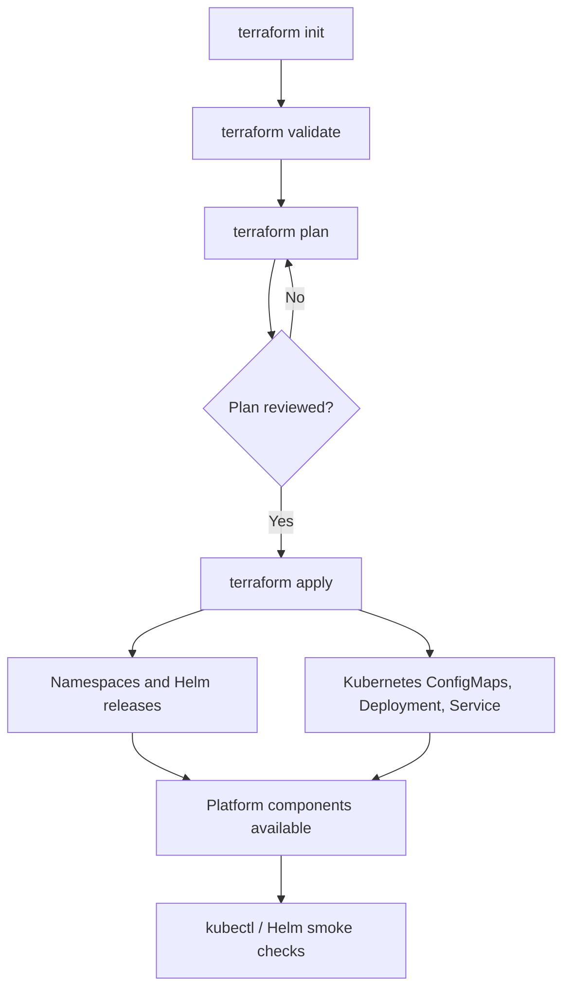

# Terraform Provisioning – AI Incident Commander

This directory contains Terraform configuration for provisioning the local Kubernetes platform used by AI Incident Commander. The current local environment targets Docker Desktop Kubernetes and uses the Kubernetes and Helm providers.

> **Scope:** this Terraform configuration provisions selected platform and supporting components. It does not currently deploy all six application services or provision every dependency used by the full event-driven platform.

## Table of contents

- [1. Purpose and scope](#1-purpose-and-scope)
- [2. Platform architecture](#2-platform-architecture)
- [3. Relationship with application services](#3-relationship-with-application-services)
- [4. Terraform directory structure](#4-terraform-directory-structure)
- [5. Provisioning overview](#5-provisioning-overview)
- [6. Terraform modules](#6-terraform-modules)
- [7. Local environment](#7-local-environment)
- [8. Configuration and secrets](#8-configuration-and-secrets)
- [9. Installation and usage](#9-installation-and-usage)
- [10. Verification and troubleshooting](#10-verification-and-troubleshooting)
- [11. Security and operational considerations](#11-security-and-operational-considerations)
- [12. Current status and next steps](#12-current-status-and-next-steps)

## 1. Purpose and scope

The Terraform configuration provides a repeatable way to provision infrastructure components for local development and demonstration. The current local root is `terraform/environments/local`.

### What is included in this directory?

- Terraform environment roots under `environments/`.
- Reusable infrastructure modules under `modules/`.
- Kubernetes resources managed through the Kubernetes provider.
- Helm releases managed through the Helm provider.
- Local configuration for observability, PostgreSQL, ingress, and a Grafana webhook receiver.

The configuration is a development/demo foundation, not a complete production landing zone. Review the actual module calls in the environment root before assuming a module is deployed.

## 2. Platform architecture

### 2.1 Infrastructure provisioning

Terraform provisions Kubernetes namespaces and selected platform services. Helm is used for packaged components; the Kubernetes provider is used for native resources such as ConfigMaps, Deployments, and Services.

### 2.2 Observability and incident response

The platform includes an observability stack and a webhook receiver intended to support metrics, logs, traces, and alert-driven workflows. The receiver is a simple demonstration component and should not be exposed publicly without authentication and authorisation.

### 2.3 LGTM components

The LGTM stack refers to Loki, Grafana, Tempo, and a metrics backend such as Mimir/Prometheus, depending on the chart configuration. The exact components and endpoints are defined by the Helm values and module variables in this repository.

## 3. Relationship with the application services

The Terraform layer supports the application platform but does not replace the lifecycle responsibilities of the services:

- `chaos-simulator` generates synthetic telemetry.
- `signal-correlator` detects incidents from signals.
- `incident-service` manages incident state and evidence.
- `investigation-agent` analyses incidents and produces recommendations.
- `remediation-service` validates approvals and controls execution.
- `command-api` exposes operator-facing commands and queries.

### 3.1 Human control for remediation

> **AI investigates and advises. Controlled automation executes. A human remains in control.**

Infrastructure provisioning must not be confused with permission for the AI agent to change the cluster. The investigation agent should not receive Kubernetes write permissions by default. Any future execution adapter must use narrowly scoped RBAC and explicit approval controls.

## 4. Terraform directory structure

The repository separates environment roots from reusable modules. The local root is `terraform/environments/local`; reusable components are located under `terraform/modules/`.

### Environment versus module

- **Environment root:** declares providers, variables, module instances, and outputs for a specific target environment.
- **Module:** encapsulates a reusable infrastructure component and its inputs/outputs.

Terraform state is local in the current setup. Protect it because state can contain sensitive values.

## 5. Provisioning overview

The current `environments/local/main.tf` declares four modules:

1. `grafana-stack` in namespace `monitoring`.
2. `postgresql` with release `notebook-postgresql` in namespace `database`.
3. `traefik` in namespace `traefik`.
4. `grafana-webhook-receiver` in namespace `monitoring`.

Dependencies within modules determine the order of their underlying resources. Terraform may execute independent modules in parallel.



## 6. Terraform modules

### 6.1 `grafana-stack`

**Purpose:** install a combined Grafana LGTM stack using the PromptlyLabs Helm chart.

The module:

- Creates the requested namespace (in the local environment: `monitoring`).
- Installs `cert-manager` (default version `v1.18.2`).
- Installs the OpenTelemetry Operator (default chart version `0.122.1`).
- Installs the `lgtm` Helm chart.
- Configures Grafana, Prometheus, Loki, and Tempo through Helm values.
- Disables the OpenTelemetry Operator embedded in the umbrella chart because the operator is installed separately.
- Configures Tempo metrics generation and remote write to the configured Prometheus service endpoint.

Review the chart values and module variables before changing versions or endpoints. The module also contains a local provisioning step for an OpenTelemetryCollector patch; this currently introduces a dependency on PowerShell and on the expected Kubernetes resource being present.

### 6.2 `postgresql`

**Purpose:** deploy PostgreSQL through a Helm release in the `database` namespace.

The module exposes connection-related outputs for application configuration. Verify the service name and DNS hostname against the actual Helm release. The current output implementation has been identified as a point requiring review: `connection_host` appears to reference a MongoDB hostname even though this module provisions PostgreSQL.

### 6.3 `traefik`

**Purpose:** deploy Traefik as the ingress component in the `traefik` namespace.

The local configuration uses a single replica. This is suitable as a local development baseline, not as a highly available production ingress configuration.

### 6.4 `grafana-webhook-receiver`

**Purpose:** deploy a small Kubernetes webhook receiver in the `monitoring` namespace.

The module creates the Kubernetes resources required by the receiver, including its ConfigMap, Deployment, and Service. The example receiver listens on port `8080` and exposes a health endpoint. It is a demonstration scaffold; authentication, authorisation, payload validation, and network restrictions must be added before use beyond a local environment.

### 6.5 `alloy`

The repository contains a separate Alloy module for telemetry collection/forwarding. It is not currently called by the local environment root described above. Decide whether Alloy or the collector configuration bundled with the LGTM stack is the intended deployment, and document one authoritative path.

### 6.6 `fluxcd`

The repository contains a FluxCD module. The `flux_bootstrap_git` configuration is commented out and the FluxCD module is not currently invoked from `environments/local`. Bootstrap should only be enabled after the Git repository, credentials, deploy-key permissions, and reconciliation model have been deliberately configured.

## 7. Local environment

The local environment is configured for Docker Desktop Kubernetes.

- Kubernetes context: `docker-desktop`
- Kubeconfig: `~/.kube/config`
- Helm provider: uses the same Kubernetes context
- Grafana provider: configured using `grafana_url` and `grafana_token`

Change `config_context` when using another context, such as `kind`, `minikube`, or a different Kubernetes cluster.

### Prerequisites

- Terraform `>= 1.9`
- Docker Desktop with Kubernetes enabled, or a compatible local Kubernetes cluster
- `kubectl` with a working kubeconfig
- Helm
- PowerShell when the LGTM patch provisioner is executed
- Access to the required Helm repositories/OCI registry

## 8. Configuration and secrets

The environment includes `terraform.auto.tfvars`. In the supplied repository, this file contains example values such as `notebook`, `admin`, and `xxxx`. Treat these values only as local placeholders; never use them in a shared or production environment.

**Recommended practices:**

1. Never commit real passwords, tokens, or private keys.
2. Add local `*.tfvars` files containing secrets to `.gitignore`.
3. Keep a separate `terraform.tfvars.example` containing non-secret placeholders only.
4. Supply secrets through environment variables (`TF_VAR_*`) or a secret manager.
5. Restrict access to Terraform state; `sensitive = true` masks output but does not encrypt state.
6. Rotate any credentials that may have been exposed in a public or shared repository.

Example environment variables:

```bash
export TF_VAR_postgres_password='use-a-secret-manager'
export TF_VAR_grafana_admin_password='use-a-secret-manager'
export TF_VAR_grafana_token='use-a-secret-manager'
```

PowerShell:

```powershell
$env:TF_VAR_postgres_password = "use-a-secret-manager"
$env:TF_VAR_grafana_admin_password = "use-a-secret-manager"
$env:TF_VAR_grafana_token = "use-a-secret-manager"
```

The `grafana_url`, `grafana_token`, and `prometheus_service_url` variables must match the services that are actually reachable. The Grafana provider can authenticate successfully only when the configured Grafana instance is reachable.

## 9. Installation and usage

Run the commands from `terraform/environments/local`.

### 9.1 Check the Kubernetes context

```bash
kubectl config current-context
kubectl cluster-info
kubectl get nodes
```

The current provider configuration expects `docker-desktop`.

### 9.2 Initialise Terraform

```bash
terraform init
```

### 9.3 Format and validate the configuration

```bash
terraform fmt -recursive
terraform validate
```

### 9.4 Review the plan

```bash
terraform plan
```

Carefully review which namespaces, Helm releases, Deployments, ConfigMaps, and Services will be created or changed.

### 9.5 Apply the configuration

```bash
terraform apply
```

Confirm the proposed changes only after reviewing the plan.

### 9.6 Inspect outputs

```bash
terraform output
```

Sensitive outputs remain masked according to their declarations. Use `terraform output -raw <name>` only when explicitly required.

### 9.7 Destroy the provisioned resources

```bash
terraform destroy
```

`destroy` removes resources managed by this Terraform state. Review the state and plan first. Pay particular attention to persistent volumes, databases, and data retention.

## 10. Verification and troubleshooting

### Kubernetes resources

```bash
kubectl get namespaces
kubectl get pods -n monitoring
kubectl get services -n monitoring
kubectl get pods -n database
kubectl get services -n database
kubectl get pods -n traefik
kubectl get services -n traefik
```

### Helm releases

```bash
helm list -A
helm status lgtm -n monitoring
helm status notebook-postgresql -n database
helm status traefik-nginx -n traefik
```

If a release is not found, check the actual release name in the Helm output.

### Webhook receiver

```bash
kubectl get deployment grafana-webhook -n monitoring
kubectl get service grafana-webhook -n monitoring
kubectl logs deployment/grafana-webhook -n monitoring
```

Test from inside the cluster:

```bash
kubectl run webhook-test -n monitoring --rm -it \
  --image=curlimages/curl --restart=Never -- \
  curl -i http://grafana-webhook:8080/health
```

### Common problems

| Problem | Check |
|---|---|
| Kubernetes provider cannot connect | Check kubeconfig path and the `docker-desktop` context |
| Helm chart download fails | Check repository/OCI access, chart version, and network connectivity |
| Grafana provider authentication fails | Check `grafana_url`, token, and reachability |
| PVC remains Pending | Check the StorageClass and available cluster storage |
| LGTM patch fails | Check PowerShell, `kubectl`, namespace, and the OpenTelemetryCollector resource |
| Webhook is unreachable | Check namespace, Service DNS, port 8080, and Pod readiness |
| Terraform plan fails on outputs | Check whether all referenced modules exist and are declared |

## 11. Security and operational considerations

### 11.1 Secrets and Terraform state

- The local backend writes state to `terraform.tfstate`.
- Terraform state may contain passwords, tokens, and other sensitive values.
- Protect the state file with appropriate filesystem permissions and do not commit it to Git.
- For shared environments, use a remote backend with encryption, access control, and state locking.
- Do not use default passwords such as `admin` or `notebook` outside an isolated local demo.

### 11.2 Kubernetes RBAC

- Use separate service accounts for each application.
- Do not grant the Investigation Agent Kubernetes write permissions by default.
- Restrict the Remediation Service to explicitly permitted resources and actions.
- Separate observability read access from remediation write access.
- Secure Grafana and webhook endpoints; the current receiver is a simple demonstration and has no authentication or authorisation.

### 11.3 Availability and storage

- The local Traefik configuration uses one replica.
- The webhook receiver defaults to one replica.
- Persistence is enabled for parts of the LGTM stack, and PostgreSQL uses a persistent volume through its Helm chart.
- This configuration is a local development/demo baseline, not a complete high-availability production environment.
- Define backup, restore, retention, resource requests/limits, and storage policies before storing production data.

### 11.4 Terraform lifecycle and drift

- Run `terraform plan` before every apply.
- Avoid manual changes that cause Terraform state to drift without being reconciled.
- Pin chart and provider versions explicitly.
- Review `local-exec` provisioners carefully; they are less declarative and may behave unexpectedly when rerun or used in a changed environment.

## 12. Current status and next steps

The following points are based on the supplied Terraform files. They form a practical checklist before full end-to-end provisioning.

### Issues identified in the current configuration

- [ ] `environments/local/outputs.tf` references `module.mongodb` and `module.qdrant`, but these modules are not declared in the current `main.tf`, and no corresponding module directories were found in the supplied Terraform directory.
- [ ] `modules/postgresql/outputs.tf` returns `connection_host` as `mongodb.${var.namespace}.svc.cluster.local`; this does not appear to match the PostgreSQL release/service.
- [ ] `grafana-stack` uses a `local-exec` PowerShell provisioner to patch an OpenTelemetryCollector. This makes provisioning dependent on PowerShell and on the exact cluster resource being present.
- [ ] `grafana-stack` generates `.generated/lgtm-otel-metrics-patch.yaml`, while the provisioner uses `otel-metrics-patch.yaml`. Check whether these are intentionally separate files and make the patch source unambiguous.
- [ ] The local environment calls `grafana-stack`; the separate `alloy` module is not connected. Document which observability variant is authoritative.
- [ ] `flux_bootstrap_git` is commented out and the FluxCD module is not called from `environments/local`.
- [ ] `terraform.auto.tfvars` contains example credentials in plaintext. Replace them with secure local values and do not commit real secrets.
- [ ] The Terraform root does not configure Kafka, Ollama, MongoDB, Qdrant, or the six application services. Document where these components are deployed separately.
- [ ] Review the Grafana webhook receiver for authentication, payload validation, and network restrictions before using it outside a local demo.

### Recommended next steps

1. Fix the references to the missing `mongodb` and `qdrant` modules in outputs, or add the intended modules.
2. Correct the PostgreSQL `connection_host` output and test service DNS from the application namespace.
3. Make LGTM patch generation and patch application consistent and idempotent.
4. Select one observability stack as the default and document the exporter/OTLP configuration for all services.
5. Enable FluxCD only after GitHub credentials, repository configuration, deploy-key permissions, and Flux bootstrap have been deliberately configured.
6. Remove secrets from tracked tfvars and, where appropriate, migrate to a secure remote Terraform backend.
7. Add `terraform fmt`, `terraform validate`, plan review, and provisioning smoke tests to CI.
8. Add missing platform components only when their lifecycle is intended to be managed by Terraform.

## Design principle

Infrastructure supports the incident response process, but it does not make operational decisions on behalf of the user:

> **AI investigates and advises. Controlled automation executes. A human remains in control.**

Terraform makes the underlying platform components reproducible; the application services remain responsible for incident detection, investigation, approval, remediation, and audit.
'''
